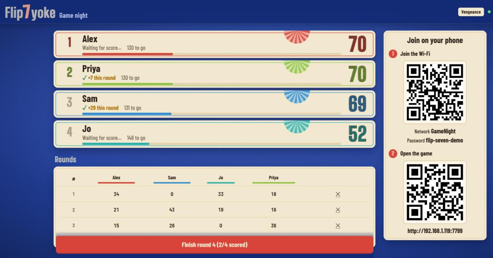
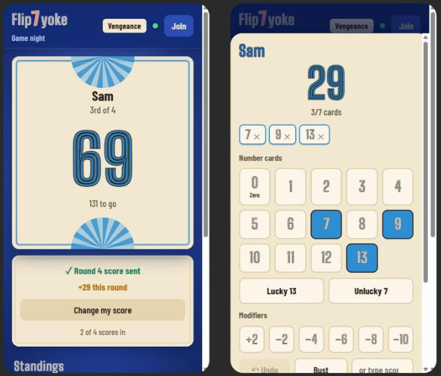
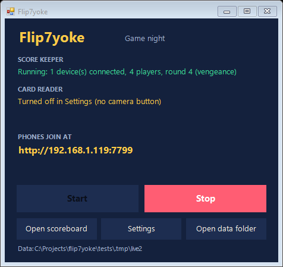
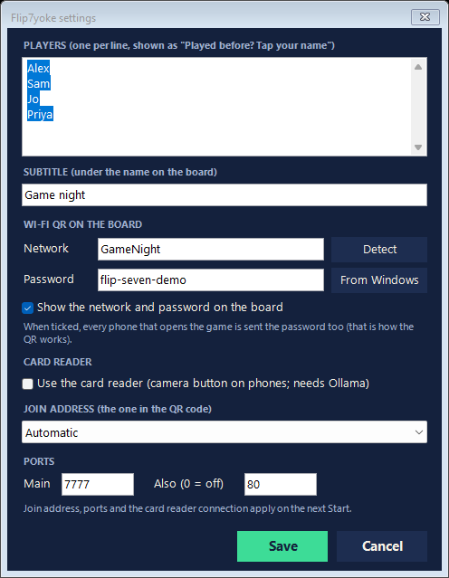

# Flip7yoke

**Unofficial score keeper for Flip 7. Not affiliated with The Op**, who publish Flip 7. The design is our own; no card art from the published game is used.

A scorekeeper for Flip 7 game nights. A big scoreboard runs on a Windows PC (on the TV, ideally), and everyone scores their own hand on their phone over your home Wi-Fi. Nobody installs an app: they scan a QR code.



- Everyone taps in their cards as they're dealt, or types a score. With the optional card reader, they can **photograph their hand** instead.
- The round finishes by itself 5 seconds after everyone has saved a score.
- Three rule sets: **Classic**, **Vengeance** (Flip 7 With a Vengeance) and **Brutal** (Vengeance plus Brutal Mode).
- History and a leaderboard across game nights.
- It runs entirely on your PC and your Wi-Fi, with no account, no cloud and no internet needed on the night.



## Install

You need a Windows 10 or 11 PC on the same Wi-Fi as the phones.

1. Download `Flip7yoke-Setup-<version>.exe` from this project's [Releases page](https://github.com/Ryan-Clinton/flip7yoke/releases).
2. Run it. If Windows says **"Windows protected your PC"**, click **More info**, then **Run anyway** ([why](#about-the-windows-warning)).
3. Click through Setup. Near the end Windows asks **"Do you want to allow this app to make changes to your device?"** for *Windows Command Processor*: that's Setup adding the firewall rule that lets phones connect. Say **Yes**. On a standard (non-admin) Windows account it asks for an administrator's password instead.

That's it. Flip7yoke itself installs just for you, without admin rights; only that firewall step needs them.

The three options on the way are:
- **Desktop shortcut.**
- **Let phones on your home Wi-Fi connect.** This adds a Windows Firewall rule for *private* networks only. If you skip it or say No, press **Allow phones** in the Flip7yoke window later.
- **Set up the card reader** (optional, see below).

### About the Windows warning

The installer isn't code-signed yet, so Windows doesn't recognise it and shows "Windows protected your PC". That's expected for this file, as long as you downloaded it from this project's Releases page. Treat the same warning on a copy from anywhere else as a reason to stop.

**To check your copy is the real one (optional):** the Releases page lists the file's SHA-256. In PowerShell, `Get-FileHash .\Flip7yoke-Setup-<version>.exe` should print the same value.

## Game night

1. Open **Flip7yoke** from the Start menu or desktop and press **Start**. The scoreboard opens in your browser. Put it full screen on the TV.
2. Players scan the QR codes on the board: the first joins the Wi-Fi (if you've added your Wi-Fi details in Settings), the second opens the game.
3. Each player taps their name (or types it) and scores their own hand each round. The board's **⋯** menu picks the rules, sets the winning score and starts a new game. Starting a new game saves the last one to History.
4. Press **Stop** when you're done. Closing the Flip7yoke window without pressing Stop leaves the game running.



## Settings

**Settings** in the Flip7yoke window:

- **Players:** the names offered under "Played before? Tap your name".
- **Subtitle:** shown under the name on the board.
- **Wi-Fi QR on the board:**
  - **Detect** fills in your network name.
  - **From Windows** tries to read the password. Windows doesn't always allow that; if not, type it.
  - When "show on the board" is ticked, every phone that opens the game is sent the network name and password too. That's how the QR code works, so only tick it if you're happy for guests to have your Wi-Fi password.
- **Card reader** on or off.
- **Join address:** "Automatic" picks the address on your home network. Choose one yourself if the QR code points somewhere phones can't reach, such as a VPN.
- **Ports:** 7777, and also 80 so phones can use the address without a port number. If something else on your PC uses 80, Flip7yoke carries on with 7777.

Names, subtitle, Wi-Fi and card reader on/off apply straight away, even on screens that are already open. Join address and ports apply on the next Start.



## The card reader (optional)

Players can photograph their hand instead of tapping cards in. A vision model running **on your PC** reads the cards; photos never leave your home network. The player always checks the reading before saving.

- **Needs:**
  - [Ollama](https://ollama.com) (free).
  - The `qwen3-vl:4b-instruct` model, a 3.3 GB download.
  - A graphics card with 6 GB or more for good speed: about 3 to 5 seconds a photo on a GTX 1080. It works without one, but slowly.
- **Setting up:** tick it in Setup, or use the button in the Flip7yoke window. Either installs Ollama if it's missing and downloads the model, in a window that shows progress.
- **When it's not available:** the camera button is simply hidden, and everything else works. If Ollama stops during a game, the button disappears within about 30 seconds and comes back when Ollama does.
- **Photos:** the last 30, with what was read from them, are kept in the data folder (below) so a misread can be checked.
- **Rules:** set the rules to match your deck before photographing, because Classic and Vengeance cards read differently.

## Your data

Everything Flip7yoke saves is in `%LOCALAPPDATA%\Flip7yoke` (**Open data folder** in the window):

| File | What |
|---|---|
| `state.json` | The current game, with `state.json.bak` as a backup |
| `history.json` | Finished games, for History and the leaderboard |
| `config.json` | Your settings |
| `scans\` | The last 30 card photos |
| `logs\server.log` | What the score keeper did (useful when something goes wrong) |

Upgrading never touches this folder. Uninstalling asks whether to delete it, and the answer defaults to **No**, so a reinstall brings your history back. To keep a backup, copy the folder.

## Uninstall

Use **Settings > Apps > Installed apps > Flip7yoke > Uninstall** in Windows.
- It stops Flip7yoke first (saving the game) and removes the program and shortcuts.
- It removes the firewall rule Setup added, which needs your permission once.
- Windows may also have made its own firewall rule earlier, if it ever asked "Allow access?" for the program; it may call it "Node.js JavaScript Runtime". Uninstall leaves those alone. To remove them, use **Windows Security > Firewall & network protection > Allow an app through firewall**.
- It never removes Ollama or its model; uninstall Ollama separately if you want the space back.

## If something goes wrong

- **A phone can't open the game:**
  - Make sure it's on the same Wi-Fi as the PC, not mobile data or a guest network.
  - If the window says "Phones may be blocked by the Windows firewall", press **Allow phones**.
  - Some routers keep Wi-Fi devices apart ("client isolation" or "AP isolation"). Turn that off in the router, or use a network that allows it.
  - One Android phone's Chrome couldn't reach port 7777 but its Samsung Internet browser could. Typing the address without `:7777` (port 80) also helps.
- **"Port 7777 is in use by another program":** another program has the port. Close it, or change **Ports** in Settings.
- **"Flip7yoke didn't finish installing":** an upgrade was interrupted. Run the installer again; your scores aren't affected.
- **"Scores not saving"** on the board: Windows refused to save, because of a full disk or a file held by antivirus or backup software. The message says why. Flip7yoke keeps trying and the warning clears once a save works.
- **The Flip7yoke window doesn't open:** some work or school PCs block PowerShell scripts. Run `Flip7yoke-server.exe` from the install folder instead; it starts the score keeper without the window, and the board is at `http://localhost:7777/board`.

## Who can change the game

Anyone who can open the game on your network can enter and fix scores, start a new game or delete a past one. That's how a game night works: everyone at the table can fix a mistake. There are no accounts. The firewall rule Setup adds covers *private* networks only. Flip7yoke also refuses requests addressed to anything but your PC, which stops other websites reaching it through your browser. Run it on your home network, not on public Wi-Fi.

## For developers

Flip7yoke is a zero-dependency Node.js server (`server.js`, `lib/`), one HTML page (`public/`) and a PowerShell control window (`Flip7.ps1`).

```
node run.js                  # run from the repo; restarts itself when the code changes
npm test                     # gameplay, lifecycle and control window tests
npm install                  # once: the build tool (postject)
npm run build                # dist\Flip7yoke-server.exe (Node 22.20.0 exactly, see .node-version)
npm run installer            # dist\Flip7yoke-Setup-<version>.exe and .sha256 (needs Inno Setup 6.7)
node tools/eval-scans.js     # card-reader accuracy check (needs the test photos, which aren't in the repo)
```

Run from the repo, the data lives in the project folder; set `FLIP7_DATA` to use another one. `HANDOVER.md` has the detail, and `docs/installer-spec.md` the design of the Windows packaging.

## Licence

Flip7yoke is MIT licensed (`LICENSE`). It includes:
- Node.js (MIT).
- The Barlow and Big Shoulders fonts (SIL Open Font License 1.1).
- qrcode-generator (MIT).

The full texts are in `THIRD-PARTY-NOTICES.txt` and `licenses/`.
